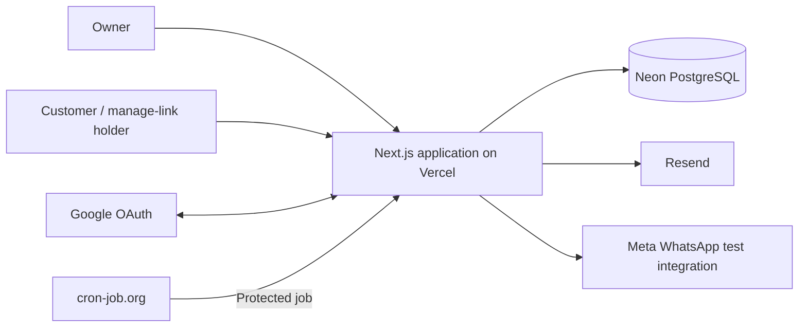

# TrimTime — Architecture

**Status:** Approved target architecture from the project architecture interview. This document records selected implementation choices; it is not evidence that they are implemented.

## 1. Purpose and authority

TrimTime is a public portfolio demo of barber-shop booking. It uses one Next.js application, organized by business capability, with server-owned data access and transactional scheduling.

- [PRD.md](PRD.md) owns product scope, journeys, business rules, and acceptance criteria.
- [SPEC.md](SPEC.md) owns technical behavior and required outcomes.
- This document owns the approved system organization and mechanisms used to satisfy those outcomes.
- [AGENTS.md](../AGENTS.md) owns agent instructions and project commands.
- [APP_ROUTES.md](APP_ROUTES.md) records application pages, canonical path decisions, and proposed routes that may be revised through explicit decisions.
- [DESIGN.md](DESIGN.md) owns visual tokens, component styling, responsive layouts, and interaction details.

The SPEC predates this architecture interview. Where it labels a mechanism as unselected, the specific choices recorded here are now approved. Related unanswered policies remain open; selecting a mechanism does not resolve an entire OTQ or change product requirements.

The local implementation includes marketing/owner host routing, Google owner authentication, database sessions, draft-shop persistence/settings, shared UI, and unit/database/browser test harnesses. Public booking, customer management, scheduling, and notifications remain target capabilities. [ROADMAP.md](ROADMAP.md#status) and its dated reports record verified scope and the approved hosted-verification deferral. Installed versions and scripts remain authoritative in `package.json` and the lockfile.

## 2. System and deployment

One Next.js App Router application contains marketing pages, owner administration, public shop pages, customer management, and HTTP/job endpoints. Database-backed server code uses the Node.js runtime. There is no separate backend deployment.



| Host | Responsibility |
| --- | --- |
| `<domain>` | Marketing site |
| `app.<domain>` | Owner dashboard, Google sign-in, OAuth callback, and owner authentication endpoints |
| `<shop>.<domain>` | Public booking and customer manage-link pages |

All hosts resolve to the same deployment. A root-level Next.js `proxy.ts` validates the configured marketing/owner host and rewrites owner page requests to an internal `/owner` route prefix while keeping public URLs unchanged. The prefix is not publicly addressable; API routes remain at their public technical paths and enforce their own host policy. Marketing and owner pages remain separate destinations. Public shop-host rewrites are added with the booking routes. Owner session cookies are host-only on `app.<domain>`; customer flows use public-shop or booking-link authority. Host routing identifies a requested surface/shop, never owner permission. Actual domain, DNS, trusted forwarding inputs, and preview/local host configuration remain open.

**Selected stack:** Next.js App Router, TypeScript, Tailwind, shadcn/ui, Zod, Better Auth with its Drizzle adapter, Drizzle ORM, and Neon PostgreSQL. Form and calendar libraries are deferred until their features need them.

The shared `server/hosts.ts` policy accepts exact configured marketing/owner hosts, rejects malformed/comma-separated hosts and conflicting `x-forwarded-host`, and requires the configured owner origin for owner writes. Proxy performs no database/session lookup and never supplies authority headers. Actions retain host/origin validation and session/ownership checks independently of Proxy. Forwarded-host trust must only change after verified ingress behavior and an approved contract. Framework resources and the current public brand/icon assets bypass Proxy; `/design-system` is shared by the configured hosts. Other marketing page paths and unsupported shop hosts return HTTP 404 before rendering. Local verification records the automated Proxy checks; provider/hosted verification remains pending.

Use Drizzle's `node-postgres` adapter with a reusable `pg` pool, Neon's pooled application connection, and Vercel's pool lifecycle support. Migrations use a separate direct connection. Interactive transactions must retain one database connection through their checks and writes. See [Vercel pool guidance](https://vercel.com/kb/guide/connection-pooling-with-functions) and [Neon connection guidance](https://neon.com/docs/connect/choose-connection).

### 2.1 Owner appointment navigation

The owner calendar, management, sign-in, and setup paths are approved in [APP_ROUTES.md](APP_ROUTES.md#2-page-inventory); marketing/customer path proposals retain their recorded status. The calendar is the target main dashboard surface, with Calendar, Services, Barbers, Availability, Activity, and Settings navigation; the current draft-shop home does not implement the calendar workflow.

Use Next.js App Router intercepted routes with a parallel Dialog slot for appointment details and creation reached through client navigation from the calendar. The canonical appointment routes render standalone pages on direct visits and full refreshes. Use responsive shadcn Dialogs, with full-screen sizing when needed on phones. Both presentations reuse feature-owned appointment views/forms and the same authorized operations; presentation never substitutes for owner authorization.

Provide null defaults for inactive modal slots and explicit clearing routes when navigating away so stale Dialogs do not persist. Scope interception to calendar entry behavior. Preserve the calendar's date, view, barber filter, and scroll during the modal history cycle. Back dismisses and Forward reopens; explicit dismissal and successful creation return to the calendar without leaving a stale modal entry active. Standalone pages provide a calendar link.

Follow [SPEC §6.6.1](SPEC.md#661-owner-calendar-interaction-contract) for save and unsaved-change behavior. Browser Back discard confirmation requires dedicated browser verification; intercepted routing alone does not implement that guard. Native browser unload/refresh constraints must not be presented as a guaranteed custom discard Dialog.

Implementation must consult the installed Next.js intercepted/parallel-route guides. Those conventions support the selected navigation pattern but do not prove this application's focus, history, authorization, or discard behavior.

## 3. Code organization

Use the approved repository-root organization. The tree combines existing infrastructure with future feature directories; introduce those features only when their implementation needs them:

```text
trimtime/
├── proxy.ts                 # Host routing to internal owner destinations
├── app/                     # Routes, layouts, thin pages, HTTP adapters
├── features/
│   ├── shops/
│   ├── catalog/
│   ├── barbers/
│   ├── availability/
│   ├── appointments/
│   └── notifications/
├── db/
│   ├── schema/              # Domain-grouped Drizzle definitions
│   ├── migrations/          # Central versioned Drizzle migrations
│   └── index.ts             # Server-only pool and database client
├── server/                  # Trusted context and shared server primitives
├── components/ui/           # Shared shadcn primitives
├── lib/                     # Small shared types and pure utilities
└── tests/e2e/               # Browser journeys
```

Central schema modules include shops, barbers, services, availability, appointments, and notifications. The shared occupied-interval table belongs in this central schema as well. Exact physical schema, identifier types, and field representations remain to be designed. Central schema ownership does not centralize business logic.

A feature follows this convention, with optional files created only when useful:

```text
features/catalog/
├── components/
├── actions.ts
├── mutations.ts
├── queries.ts
├── schemas.ts
└── tests/
    ├── schemas.test.ts
    └── queries.integration.test.ts
```

| Location | Responsibility |
| --- | --- |
| `app/**/page.tsx` | Thin Server Component: resolve route inputs, call feature reads, and render feature views |
| `components/` | Feature-owned presentation and client interaction |
| `actions.ts` | Server Action adapter: establish trusted context, validate input, invoke an operation, and adapt its result |
| `mutations.ts` | Server-only business writes, permission checks, current-state validation, and transaction orchestration |
| `queries.ts` | Server-only authorized reads returning explicitly shaped data |
| `schemas.ts` | Zod input schemas and inferred types; browser-safe schemas contain no server imports |
| `tests/` | Tests owned by the feature |

Pages and HTTP handlers contain no SQL or duplicated business rules. Database, credential, and mutation modules enforce server-only import boundaries. Client components receive deliberate view data and action results, not unrestricted database rows or secrets.

## 4. Feature ownership and dependencies

| Feature | Owns | Product reference |
| --- | --- | --- |
| `shops` | Setup, publication, contact/address settings, subdomain permanence, and time-zone locking | FR-005–FR-012 |
| `catalog` | Services, prices, durations, archival, and catalog changes | FR-013, FR-016–FR-017 |
| `barbers` | Barber profiles, service assignments, and retirement guards | FR-014–FR-015 |
| `availability` | Working schedules, overrides, restrictions, time blocks, eligibility evaluation, and slot calculation | FR-018–FR-023 |
| `appointments` | Public/owner booking lifecycle, saved service details, manage links, attendance, and booking history | FR-024–FR-046 |
| `notifications` | Message eligibility, persisted work, attempts, reminders, retries, and delivery evidence | FR-047–FR-061 |

Authentication/context construction and abuse-control primitives are shared server infrastructure. Cleanup removes appointment-related history according to the PRD; it does not become a new business feature or select an unapproved job cadence.

The customer booking flow and owner calendar are separate UI compositions over these capabilities. They share appointment rules. Dedicated presentation modules can be introduced later if their complexity justifies them.

Cross-feature calls use explicit named entry points, such as an exported query or mutation, rather than private helpers. A universal barrel file is not required. Dependencies remain directed and cycle-free; shared UI/utilities do not import business features.

`appointments` calls `availability` to validate a proposed reservation. Both use small shared server primitives for occupied-interval access. `availability` does not import appointment lifecycle operations: schedule edits inspect the shared occupancy data rather than introducing a reverse feature dependency.

Domain writes go through their owning operations. Shared reservation writes are the deliberate common primitive beneath availability/appointments. Notification-work capture is an explicit transactional entry point; its worker uses narrow, shop-scoped current-state projections without calling back into appointment mutations. Sharing schema definitions grants no authorization and is not permission to bypass feature rules.

## 5. Trust and action contracts

Better Auth manages Google owner authentication and sessions. Trusted server constructors establish distinct contexts for owners, public-shop requests, booking-link holders, and protected jobs. Provider delivery evidence needs its own verified adapter when its protocol is selected.

Context is not permission. Each query/mutation enforces the scope and current-state requirements of its operation. An owner context does not grant job authority; a booking context grants access to one booking only. Client-supplied actor IDs, shop IDs, role flags, and email addresses cannot construct trusted authority. Owner onboarding must also handle an authenticated principal who has not created a shop yet.

Actions and HTTP handlers verify the applicable credentials and construct context before calling reusable operations. Route-level checks and hidden UI controls do not replace operation-level checks. Server-side Zod validation is authoritative; compatible client validation is for feedback.

Shared action-result types use the agreed discriminated union:

```ts
export type ActionFieldErrors = Record<string, string[]>;

export type ActionError = {
  message: string;
  code?: string;
};

export type ActionResult<T> =
  | { success: true; data: T }
  | {
      success: false;
      error: ActionError;
      fieldErrors?: ActionFieldErrors;
    };
```

`T` must be safe for the client boundary; the generic does not guarantee serialization or privacy. Define feature-specific inputs and view/result types deliberately. This envelope is for Server Action returns, not a mandated wrapper for every internal query or HTTP response. Exact error codes, HTTP mappings, and transfer representations remain open. Expected validation/business failures are distinguishable from unexpected failures, whose internal details must stay server-side.

See [SPEC access control](SPEC.md#5-authentication-authorization-and-access-control), [SPEC validation](SPEC.md#8-validation-rules-and-error-handling), and [React serialization rules](https://react.dev/reference/rsc/use-server#serializable-arguments-and-return-values).

## 6. Scheduling and transaction integrity

Appointments and time blocks retain their own domain records but reserve barber time through one shared occupied-interval table. A PostgreSQL exclusion constraint rejects overlapping protected intervals for the same barber. Intervals use `[start, end)` so end-to-start adjacency remains valid. Different barbers retain independent capacity. See [PostgreSQL range constraints](https://www.postgresql.org/docs/current/rangetypes.html#RANGETYPES-CONSTRAINT).

Schedule-sensitive writes acquire the same transaction-held lock on the shop before reading the authoritative scheduling state. This includes booking creation/replacement/restoration and relevant hours, block, service, barber-eligibility, and time-zone edits. Recheck permission, lifecycle, availability, and related invariants under that lock, then commit consistent domain records and occupancy together.

The lock coordinates rules across tables; the exclusion constraint independently protects overlap. Shop writes may briefly wait for each other, but this is not shop-wide appointment capacity. Keep transactions short and provider/network calls outside them. See [PostgreSQL row locks](https://www.postgresql.org/docs/current/explicit-locking.html#LOCKING-ROWS).

A failed reschedule rolls back the replacement transaction, preserving the original booking and reservation. A committed cancellation releases occupancy; restoration must revalidate before reserving again. First-booking time-zone locking and required historical snapshots are part of the same consistent write boundary.

Availability queries are advisory. Booking commitment repeats authoritative validation using the same rule evaluation. UTC instants, IANA shop zones, elapsed intervals, and local-date horizon semantics remain as specified in [SPEC availability](SPEC.md#63-availability-semantics-and-established-predicates).

Exact occupancy/state predicates, multi-shop lock ordering, stale-edit/replay responses, DST boundary conversion, and remaining lifecycle ambiguities are not invented here. See [SPEC concurrency](SPEC.md#9-state-transitions-concurrency-and-consistency) and its open questions.

## 7. Notification work and shared limits

Capture intended notification work in a small PostgreSQL table within the transaction that commits the relevant business change. Rollback leaves neither a committed change nor its work. After commit, delivery can be attempted independently; the protected job claims due work and handles eligible retries. Provider failure does not roll back the committed business change.

Work and evidence identify the relevant booking/schedule/contact event and channel. Before dispatch, recheck current eligibility and suppress obsolete unsent work. Persist actual attempts and outcomes per channel; acceptance, delivery evidence, failure, unknown results, and skips remain distinguishable. Job claiming does not create an exactly-once guarantee.

cron-job.org invokes the protected reminder/retry endpoint on the confirmed ten-minute cadence. Verify its secret before processing. The exact endpoint, lease/recovery protocol, batch bounds, retry delays, and immediate post-commit dispatch mechanism remain open. See [SPEC notifications and scheduling](SPEC.md#12-background-jobs-notifications-and-scheduling).

PostgreSQL also stores public rate-limit records and the shared outbound budget, with atomic enforcement across instances. Their coordination is separate from per-shop scheduling locks because the send budget spans shops. Neither in-memory counters nor per-instance state can enforce these global limits.

Use the [PRD's abuse/budget rules](PRD.md#6-business-rules-constraints-and-invariants). Hourly windows, reset boundary, key normalization, and accounting for reserved or uncertain sends remain open; do not equate a budget reservation with an actual provider attempt.

## 8. Manage-link protection

Manage links use cryptographically random opaque tokens bound to one booking. Store a hash for verification and an encrypted recoverable copy for sending the same link again. Keep the encryption key outside the database; recoverable token material stays server-only except when intentionally showing/sending that booking's manage link.

Every use checks current booking/shop scope, revocation, expiry, and the operation's permission. Ordinary lifecycle changes preserve token identity while validity follows the relevant scheduled end. Contact correction revokes previous tokens and issues a replacement. Reading a link never performs a mutation.

Hash-only storage cannot reproduce the original link for resending; encrypted recovery is the selected tradeoff. Token/hash/encryption parameters, key rotation, URL placement, and precise expiry-day arithmetic remain open. See [SPEC capability rules](SPEC.md#52-capability-lifetime-and-revocation).

## 9. Verification and maintenance

- **Vitest:** pure rules/schema tests and real-database integration tests, including permission scopes and concurrent writes. Unit and database suites use separate configs.
- **Playwright:** rendered owner/customer journeys, direct-request access checks, and client-visible success/failure behavior. Phase 00 uses Chromium at desktop, tablet, and phone viewports.
- **Disposable local PostgreSQL:** Docker Compose runs a pinned PostgreSQL 18 image with loopback-only port binding and tmpfs storage. Database tests require the exact test URL and verify Compose ownership and container configuration before connecting; they never fall back to `DATABASE_URL`.
- **Migrations:** Drizzle applies ordered SQL from `db/migrations`; `MIGRATION_DATABASE_URL` is separate from the app's `DATABASE_URL`. Phase 00 keeps the application migration journal empty until the first product schema is introduced.
- **Dedicated provider verification:** actual approved email/WhatsApp tests remain necessary to prove live integration capability; simulations alone do not prove delivery.

Feature tests live with the feature. Shared database fixtures support integration tests; browser journeys live centrally. Current scripts and prerequisites are in [README.md](../README.md) and [AGENTS.md](../AGENTS.md). Follow [SPEC testing strategy](SPEC.md#14-testing-strategy-and-acceptance-scenarios) for the evidence boundary of each feature.

Update this document when approved boundaries or architectural mechanisms change. Keep phase status in the delivery roadmap and dated, local-only execution evidence under ignored `docs/reports/`.

## 10. Remaining decisions

The structural choices above are settled. Resolve remaining details when the affected phase needs them; the document is not blanket implementation readiness.

| Area | Still open | SPEC references |
| --- | --- | --- |
| Data and time | Physical fields/IDs, price representation, occupancy predicates, schedule representation, time library, grid/DST boundaries, expiry/retention arithmetic | OTQ-003, OTQ-007, OTQ-014, OTQ-016 |
| Requests and security | Routes marked proposed in APP_ROUTES.md, remaining job/provider endpoint paths and error codes, hosted forwarding/trusted IP inputs, customer origin defenses, crypto parameters/key rotation, and any database policy hardening. Owner session/host/origin policy is selected in §2 and the approved Phase 01 plan. | OTQ-002, OTQ-005–OTQ-006, OTQ-013 |
| Limits and dispatch | Rate/reset accounting, bot provider, claim recovery, immediate dispatch, retry classification/backoff, manual-resend identity, and uncertain outcomes | OTQ-008–OTQ-010, OTQ-018 |
| Providers and hosting | Actual domain/senders/recipients/templates, credentials/API versions, verified outcome collection, and preview/local setup | OTQ-006, OTQ-011–OTQ-012 |
| Product-dependent behavior | Stale offers, lifecycle/edit predicates, contact/consent effects, publication validation, and other acknowledged PRD gaps | OTQ-015–OTQ-016, OTQ-019–OTQ-020; PI-001–PI-017 |
| Presentation and tooling | Feature-specific detail under [DESIGN.md](DESIGN.md), remaining form/calendar choices and package versions, accessibility/performance measurement; owner calendar/Dialog navigation is selected in §2.1. Test-container configuration is established in §9. | Remaining OTQ-001, OTQ-017 |

Refer to [SPEC open technical questions](SPEC.md#16-open-technical-questions) and [PRD issues](SPEC.md#17-prd-issues) for full context. Their original IDs stay stable. These architecture selections narrow the questions; they do not silently close unrelated policies or claim implementation/test evidence.
