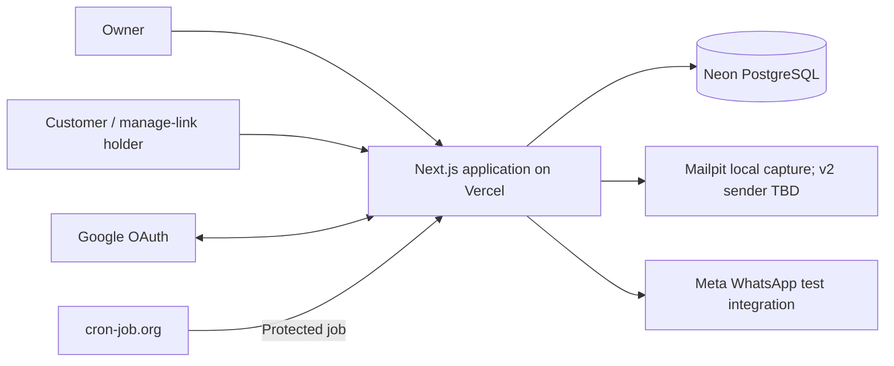

# TrimTime — Architecture

**Status:** Approved target architecture from the project architecture interview. This document records selected implementation choices; it is not evidence that they are implemented.

## 1. Purpose and authority

TrimTime is a public portfolio demo of barber-shop booking. It uses one Next.js application, organized by business capability, with server-owned data access and transactional scheduling.

- [PRD.md](PRD.md) owns product scope, journeys, business rules, and acceptance criteria.
- [SPEC.md](SPEC.md) owns technical behavior and required outcomes.
- This document owns the approved system organization and mechanisms used to satisfy those outcomes.
- [AGENTS.md](../AGENTS.md) owns agent instructions and project commands.
- [APP_ROUTES.md](APP_ROUTES.md) records application pages, canonical path decisions, and proposed routes that may be revised through explicit decisions.
- [DESIGN.md](DESIGN.md) owns visual tokens, component styling, responsive layouts, and interaction details.

The SPEC predates this architecture interview. Where it labels a mechanism as unselected, the specific choices recorded here are now approved. Related unanswered policies remain open; selecting a mechanism does not resolve an entire OTQ or change product requirements.

The local implementation includes marketing/owner host routing, owner authentication, shop persistence/settings, catalog and availability management, publication readiness, public booking, customer manage links with explicit cancellation, initial local Mailpit email capture, and owner-scoped message Activity. Local Mailpit capture is not inbox delivery. Hosted email, later notification events, automatic retries, customer replacement, and other customer writes remain deferred or unresolved. [ROADMAP.md](ROADMAP.md#status) records current evidence and gates. Installed versions and scripts remain authoritative in `package.json` and the lockfile.

## 2. System and deployment

One Next.js App Router application contains marketing pages, owner administration, public shop pages, customer management, and HTTP/job endpoints. Database-backed server code uses the Node.js runtime. There is no separate backend deployment.



| Host              | Responsibility                                                                      |
| ----------------- | ----------------------------------------------------------------------------------- |
| `<domain>`        | Marketing site                                                                      |
| `app.<domain>`    | Owner dashboard, Google sign-in, OAuth callback, and owner authentication endpoints |
| `<shop>.<domain>` | Public booking and customer manage-link pages                                       |

All hosts resolve to the same deployment. A root-level Next.js `proxy.ts` validates configured marketing/owner hosts and blocks direct requests to internal `/owner` paths. Host-conditioned `beforeFiles` rewrites in `next.config.ts` map owner public paths to that prefix and a validated public shop root to `/shop`. API routes remain at their public technical paths and enforce their own host policy. Marketing, owner, and public-shop pages remain separate destinations. For a valid shop sibling host, Proxy permits only GET/HEAD `/`, performs a minimal uncached database existence lookup, returns a static HTTP 404 for unknown shops and unsupported paths, and continues a known root to the host-conditioned rewrite to `/shop`. A database failure returns generic HTTP 503. Proxy performs no session, catalog, availability, or owner-authorization work. This is the approved narrow exception to the no-database Proxy rule; public reads independently enforce scope and publication. Owner session cookies are host-only on `app.<domain>`; customer flows use public-shop or booking-link authority. Host routing identifies a requested surface/shop, never owner permission. Actual domain, DNS, trusted forwarding inputs, and preview/local host configuration remain open.

**Selected stack:** Next.js App Router, TypeScript, Tailwind, shadcn/ui, Zod, Better Auth with its Drizzle adapter, Drizzle ORM, and Neon PostgreSQL. Form and calendar libraries are deferred until their features need them.

The shared `server/hosts.ts` policy accepts exact configured marketing/owner hosts and syntactically valid shop siblings, rejects malformed/comma-separated hosts and conflicting `x-forwarded-host`, and requires the configured owner origin for owner writes. Proxy never supplies authority headers. Actions retain host/origin validation and session/ownership checks independently of Proxy. Forwarded-host trust must only change after verified ingress behavior and an approved contract. Framework resources and the current public brand/icon assets bypass Proxy; `/design-system` is shared by configured marketing and owner hosts only. Local Vercel wildcard DNS/TLS and forwarding verification remain pending.

`server/origin-config.mts` is the shared pure origin resolver used by Next configuration and server code; `server/config.ts` is the server-only accessor. Production requires explicit, distinct HTTPS `MARKETING_ORIGIN` and `APP_ORIGIN` authorities. Values are bare origins, with a single trailing slash normalized; custom ports are supported. `BETTER_AUTH_URL` is optional and derives from `APP_ORIGIN`, or must match it when supplied. Development and the E2E runner may use HTTP origins. Production origin values must be available to both build and runtime for rewrites and canonical URLs. These configuration checks do not verify DNS, ingress forwarding, OAuth callbacks, or cookies in the hosted deployment.

Use Drizzle's `node-postgres` adapter with a reusable `pg` pool, Neon's pooled application connection, and Vercel's pool lifecycle support. Migrations use a separate direct connection. Interactive transactions must retain one database connection through their checks and writes. See [Vercel pool guidance](https://vercel.com/kb/guide/connection-pooling-with-functions) and [Neon connection guidance](https://neon.com/docs/connect/choose-connection).

The entry surfaces retain their existing hosts and paths. Marketing examples are static presentation; the booking notice, FAQs and mobile menu have only local UI behavior. Setup stages the owner's unsaved details in component memory, validates them with the existing shared schema before review, then submits the reviewed values to the existing Server Action only on final confirmation. Server authorization, strict input validation, uniqueness and the one-shop boundary remain authoritative. Canonical-address presentation derives from the configured marketing origin, preserving scheme and port; it does not establish slug availability or hosted resolution.

### 2.1 Owner appointment navigation

The owner calendar, management, sign-in, and setup paths are approved in [APP_ROUTES.md](APP_ROUTES.md#2-page-inventory); marketing/customer path proposals retain their recorded status. The calendar is the persisted own-shop dashboard, with Calendar, Services, Barbers, Availability, Activity, and Settings navigation. Activity reads persisted own-shop notification evidence. Both surfaces are authenticated and shop-required.

The implemented management routes share the `(management)` layout: a persistent 208px desktop sidebar above 900px, with a compact header and accessible navigation Sheet at narrower widths. Server components load the signed-in owner's shop and saved appointment records; the calendar computes its initial date in the shop time zone, accepts URL-backed date/day-week/barber state, and reads only bookings overlapping the requested range. Appointment detail and creation routes use an intercepted parallel slot for calendar navigation and standalone pages for direct visits/refreshes. The shared owner mutation checks current service/barber eligibility, exact-minute boundaries, schedule fit, conflicts, authorization, and recovery keys inside the booking transaction. Creation revalidates calendar and Activity after commit; channel work dispatches after the response. Calendar content is no longer sample data. Existing management and sign-out operations retain their real contracts. Settings uses the existing authorized shop operations and an owner-scoped identity/time-zone-lock projection; name/contact/time-zone saves and publication changes revalidate the internal management layout so contextual labels update together. Settings discard restores the last successful save even after a later rejected edit.

Use Next.js App Router intercepted routes with a parallel Dialog slot for appointment details and creation reached through client navigation from the calendar. The canonical appointment routes render standalone pages on direct visits and full refreshes. Use responsive shadcn Dialogs, with full-screen sizing when needed on phones. Both presentations reuse feature-owned appointment views/forms and the same authorized operations; presentation never substitutes for owner authorization.

Provide null defaults for inactive modal slots and explicit clearing routes when navigating away so stale Dialogs do not persist. Scope interception to calendar entry behavior. Preserve the calendar's date, view, barber filter, and scroll during the modal history cycle. A root-lifetime route observer uses committed `usePathname`/`useSearchParams` values after browser traversal before forwarding or restoring the dirty-change guard. The guard waits for an accessible appointment entry layer before remounting above it; Keep restores focus to the visible replacement control when Next.js Activity retains the previous DOM node. Standalone pages provide a calendar link.

Follow [SPEC §6.6.1](SPEC.md#661-owner-calendar-interaction-contract) for save and unsaved-change behavior. Current browser evidence covers the individual Close/Escape/outside-click/Back keep/discard matrix, repeated Back/Forward focus behavior, direct and intercepted create/detail parity, filtered-week return context, validation/conflict/lost-response recovery, six responsive widths, keyboard containment, and a measured ≥3:1 appointment-dialog focus ring. These results are recorded in the local Phase 08 report; the broader physical-device and dedicated screen-reader checks remain unverified. Native browser unload/refresh constraints must not be presented as a guaranteed custom discard Dialog.

Implementation must consult the installed Next.js intercepted/parallel-route guides. Those conventions support the selected navigation pattern but do not prove this application's focus, history, authorization, or discard behavior.

## 3. Code organization

Use the approved repository-root organization. The tree combines existing infrastructure with future feature directories; introduce those features only when their implementation needs them:

```text
trimtime/
├── proxy.ts                 # Host validation and public-path protections
├── app/                     # Routes, layouts, thin pages, HTTP adapters
├── features/
│   ├── shops/
│   ├── catalog/
│   ├── barbers/
│   ├── availability/
│   ├── appointments/
│   └── notifications/
├── db/
│   ├── schema/              # Domain-grouped Drizzle definitions
│   ├── migrations/          # Central versioned Drizzle migrations
│   └── index.ts             # Server-only pool and database client
├── server/                  # Trusted context and shared server primitives
├── components/ui/           # Shared shadcn primitives
├── lib/                     # Small shared types and pure utilities
└── tests/e2e/               # Browser journeys
```

Central schema modules include shops, barbers, services, availability, appointments, and notifications. The shared occupied-interval table belongs in this central schema as well. Exact physical schema, identifier types, and field representations remain to be designed. Central schema ownership does not centralize business logic.

A feature follows this convention, with optional files created only when useful:

```text
features/catalog/
├── components/
├── actions.ts
├── mutations.ts
├── queries.ts
├── schemas.ts
└── tests/
    ├── schemas.test.ts
    └── queries.integration.test.ts
```

| Location          | Responsibility                                                                                              |
| ----------------- | ----------------------------------------------------------------------------------------------------------- |
| `app/**/page.tsx` | Thin Server Component: resolve route inputs, call feature reads, and render feature views                   |
| `components/`     | Feature-owned presentation and client interaction                                                           |
| `actions.ts`      | Server Action adapter: establish trusted context, validate input, invoke an operation, and adapt its result |
| `mutations.ts`    | Server-only business writes, permission checks, current-state validation, and transaction orchestration     |
| `queries.ts`      | Server-only authorized reads returning explicitly shaped data                                               |
| `schemas.ts`      | Zod input schemas and inferred types; browser-safe schemas contain no server imports                        |
| `tests/`          | Tests owned by the feature                                                                                  |

Pages and HTTP handlers contain no SQL or duplicated business rules. Database, credential, and mutation modules enforce server-only import boundaries. Client components receive deliberate view data and action results, not unrestricted database rows or secrets.

## 4. Feature ownership and dependencies

| Feature         | Owns                                                                                                  | Product reference     |
| --------------- | ----------------------------------------------------------------------------------------------------- | --------------------- |
| `shops`         | Setup, publication, contact/address settings, subdomain permanence, and time-zone locking             | FR-005–FR-012         |
| `catalog`       | Services, prices, durations, archival, and catalog changes                                            | FR-013, FR-016–FR-017 |
| `barbers`       | Barber profiles, service assignments, and retirement guards                                           | FR-014–FR-015         |
| `availability`  | Working schedules, overrides, restrictions, time blocks, eligibility evaluation, and slot calculation | FR-018–FR-023         |
| `appointments`  | Public/owner booking lifecycle, saved service details, manage links, attendance, and booking history  | FR-024–FR-046         |
| `notifications` | Message eligibility, persisted work, attempts, reminders, retries, and delivery evidence              | FR-047–FR-061         |

**Phase 02 implementation selection:** Services, barbers, and their eligibility links use `services`, `barbers`, and `barber_services` tables. Catalog values are exact `numeric` strings; composite foreign keys enforce same-shop assignments. Each owner write locks its shop row before validating/updating resources and changes active counterpart links atomically. Archived resources and their links remain stored; current offering choices exclude hidden/archived services and archived or absent eligible barbers. These decisions do not implement booking-bearing retirement guards, which remain part of Phase 06 onward.

**Phase 03 local implementation (2026-10-22):** Weekly shop and barber schedules use JSONB rows with optimistic integer revisions and shop/barber foreign-key scope. Writes lock the owner shop row; initial shop configuration copies the full week and breaks to existing active barbers atomically, and barber creation snapshots the current shop week in its transaction. Later shop edits do not recopy barber preferences. Preview reads the shop, offerings, eligibility, and both schedules in one read-only repeatable-read transaction. The `temporal-polyfill` package handles IANA local-time conversion; candidate starts use shop-local clock quarters, full-interval wall-clock membership, distinct fold instants, omitted gaps, and end-only `24:00`. These choices are recorded in [SPEC §6.3](SPEC.md#63-availability-semantics-and-established-predicates); Phase 03 tests and local execution evidence do not establish booking commitment or hosted behavior.

Authentication/context construction and abuse-control primitives are shared server infrastructure. Cleanup removes appointment-related history according to the PRD; it does not become a new business feature or select an unapproved job cadence.

The customer booking flow and owner calendar are separate UI compositions over these capabilities. They share appointment rules. Dedicated presentation modules can be introduced later if their complexity justifies them.

Cross-feature calls use explicit named entry points, such as an exported query or mutation, rather than private helpers. A universal barrel file is not required. Dependencies remain directed and cycle-free; shared UI/utilities do not import business features.

`appointments` calls `availability` to validate a proposed reservation. Both use small shared server primitives for occupied-interval access. `availability` does not import appointment lifecycle operations: schedule edits inspect the shared occupancy data rather than introducing a reverse feature dependency.

Domain writes go through their owning operations. Shared reservation writes are the deliberate common primitive beneath availability/appointments. Notification-work capture is an explicit transactional entry point; its worker uses narrow, shop-scoped current-state projections without calling back into appointment mutations. Sharing schema definitions grants no authorization and is not permission to bypass feature rules.

## 5. Trust and action contracts

Better Auth manages Google owner authentication and sessions. Trusted server constructors establish distinct contexts for owners, public-shop requests, booking-link holders, and protected jobs. Provider delivery evidence needs its own verified adapter when its protocol is selected. Mailpit is the selected local-development email sink; it captures messages for inspection but does not prove inbox delivery. Hosted v1 has no real email sender and must report email unavailable. Real email delivery is deferred to v2; Resend is tentative, not a finalized provider choice.

Context is not permission. Each query/mutation enforces the scope and current-state requirements of its operation. An owner context does not grant job authority; a booking context grants access to one booking only. Client-supplied actor IDs, shop IDs, role flags, and email addresses cannot construct trusted authority. Owner onboarding must also handle an authenticated principal who has not created a shop yet.

Actions and HTTP handlers verify the applicable credentials and construct context before calling reusable operations. Route-level checks and hidden UI controls do not replace operation-level checks. Server-side Zod validation is authoritative; compatible client validation is for feedback.

Shared action-result types use the agreed discriminated union:

```ts
export type ActionFieldErrors = Record<string, string[]>;

export type ActionError = {
  message: string;
  code?: string;
};

export type ActionResult<T> =
  | { success: true; data: T }
  | {
      success: false;
      error: ActionError;
      fieldErrors?: ActionFieldErrors;
    };
```

`T` must be safe for the client boundary; the generic does not guarantee serialization or privacy. Define feature-specific inputs and view/result types deliberately. This envelope is for Server Action returns, not a mandated wrapper for every internal query or HTTP response. Exact error codes, HTTP mappings, and transfer representations remain open. Expected validation/business failures are distinguishable from unexpected failures, whose internal details must stay server-side.

See [SPEC access control](SPEC.md#5-authentication-authorization-and-access-control), [SPEC validation](SPEC.md#8-validation-rules-and-error-handling), and [React serialization rules](https://react.dev/reference/rsc/use-server#serializable-arguments-and-return-values).

## 6. Scheduling and transaction integrity

Appointments and time blocks retain their own domain records but reserve barber time through one shared occupied-interval table. A PostgreSQL exclusion constraint rejects overlapping protected intervals for the same barber. Intervals use `[start, end)` so end-to-start adjacency remains valid. Different barbers retain independent capacity. See [PostgreSQL range constraints](https://www.postgresql.org/docs/current/rangetypes.html#RANGETYPES-CONSTRAINT).

Schedule-sensitive writes acquire the same transaction-held lock on the shop before reading the authoritative scheduling state. This includes booking creation/replacement/restoration and relevant hours, block, service, barber-eligibility, and time-zone edits. Recheck permission, lifecycle, availability, and related invariants under that lock, then commit consistent domain records and occupancy together.

The lock coordinates rules across tables; the exclusion constraint independently protects overlap. Shop writes may briefly wait for each other, but this is not shop-wide appointment capacity. Keep transactions short and provider/network calls outside them. See [PostgreSQL row locks](https://www.postgresql.org/docs/current/explicit-locking.html#LOCKING-ROWS).

A failed reschedule rolls back the replacement transaction, preserving the original booking and reservation. A committed cancellation releases occupancy; restoration must revalidate before reserving again. First-booking time-zone locking and required historical snapshots are part of the same consistent write boundary.

Availability queries are advisory. Booking commitment repeats authoritative validation using the same rule evaluation. UTC instants, IANA shop zones, elapsed intervals, and local-date horizon semantics remain as specified in [SPEC availability](SPEC.md#63-availability-semantics-and-established-predicates).

Date-specific availability stores shop and barber date rows separately from recurring weekly schedules. Each row retains a revision when its override is cleared, so stale edits cannot reset to revision zero. Date reads and previews use a repeatable-read snapshot; schedule writes lock the shop row and compare the submitted revision. A dated override replaces recurring hours and breaks, while closures, days off, and barber-scoped time blocks remain separate restrictions. Time blocks and future appointment reservations share occupied intervals; `[start, end)` ranges are protected by a PostgreSQL GiST exclusion constraint. Creating a block writes occupancy and its domain row in one transaction; removing the authorized block cascades its occupancy. Block instants remain UTC if the shop time zone later changes; dated schedules remain attached to their local calendar date.

Phase 06 selects confirmed occupancy while `end > now`, shop-row serialization for booking/configuration races, and random-key recovery for identical initial public submissions; replacement/stale-edit handling and remaining lifecycle ambiguities stay open. See [SPEC concurrency](SPEC.md#9-state-transitions-concurrency-and-consistency) and its open questions.

## 7. Notification work and shared limits

For initial public bookings, capture customer-confirmation and owner-alert work in PostgreSQL in the same transaction as the booking. Rollback leaves neither booking nor work. After the successful booking response, a server-only Next.js `after()` callback makes one best-effort dispatch per eligible email item. Messaging failure never rolls back the booking or manage link. This is not the future scheduled worker or retry mechanism.

Phase 10 customer cancellation extends this work set with one customer cancellation update and one owner cancellation alert, both committed with the cancellation event. Work and evidence identify the booking, saved content/recipient identity, message kind, and channel. Before dispatch, recheck current eligibility and suppress obsolete unsent work. Persist a per-work attempt/claim correlation; reservation, confirmed HTTP invocation, Mailpit acceptance, verified local capture, failure, unknown, and skip remain distinct. A capture requires the provider's response ID plus matching recipient and attempt header. Local capture is not delivery evidence. The process/network gap can retain budget without a confirmed invocation; no exactly-once send guarantee is claimed.

The shared initial-email budget has 100 allocations per UTC day across shops and channels. Reservations that may have reached transport remain charged; skips and other terminal outcomes are not replayed at reset or on Mailpit restart. The Mailpit HTTP requests use three-second bounds. The `VERCEL` environment disables this local transport; no hosted sender is configured. The future ten-minute protected worker, retry/backoff, lease/recovery policy, and real provider outcome collection remain open. See [SPEC notifications and scheduling](SPEC.md#12-background-jobs-notifications-and-scheduling).

PostgreSQL also stores public rate-limit records and the shared outbound budget, with atomic enforcement across instances. Their coordination is separate from per-shop scheduling locks because the send budget spans shops. Neither in-memory counters nor per-instance state can enforce these global limits.

Use the [PRD's abuse/budget rules](PRD.md#6-business-rules-constraints-and-invariants). Phase 06 resolves the initial creation window and email-key normalization. Phase 07 selects UTC reset for the 100-allocation initial local-email budget and separates reservations from confirmed attempts. Phase 10 selects ten structurally valid fresh customer-change submissions per valid manage link per rolling 60 minutes, counting stale/cutoff/state denials and excluding invalid authority or identical successful replay. Messaging-endpoint thresholds remain open; do not equate a reservation with a provider attempt.

## 8. Manage-link protection

Manage links use cryptographically random opaque tokens bound to one booking. Store a hash for verification and an encrypted recoverable copy for sending the same link again. Keep the encryption key outside the database; recoverable token material stays server-only except when intentionally showing/sending that booking's manage link.

Every use checks current booking/shop scope, revocation, expiry, and the operation's permission. Ordinary lifecycle changes preserve token identity while validity follows the relevant scheduled end. Contact correction revokes previous tokens and issues a replacement. Reading a link never performs a mutation.

Hash-only storage cannot reproduce the original link for resending; encrypted recovery is the selected tradeoff. Phase 06 selects 32-byte random base64url tokens, SHA-256 lookup hashes, AES-256-GCM recoverable ciphertext with a fresh 12-byte IV and shop/booking authenticated data, and a key ID with keys stored outside PostgreSQL. The approved URL is `https://{shop}.{configured-domain}/manage/{token}`. Expiry is current/retained scheduled end plus 168 elapsed hours, with equality denied. Key rotation and 30-day retention arithmetic remain open. See [SPEC capability rules](SPEC.md#52-capability-lifetime-and-revocation).

**Phase 06 implementation selection (2026-10-25; acceptance amended by owner):** Public booking operations use verified shop context. Bot protection and all IP-based booking-attempt and invalid-link limits are deferred to v2. PostgreSQL enforces the retained shared rolling 60-minute limit of three attempts per normalized email/shop. A random per-submission recovery key returns the same successful booking/link only for identical canonical content. The creation transaction locks the shop, rechecks the current offer and availability, and writes the confirmed booking, snapshot, occupancy, capability, first-booking time-zone lock, and notification work atomically. Owner configuration writes use the same shop lock and protect confirmed intervals while `end > now`; cancelled retained intervals do not protect edits.

**Phase 07 implementation selection (2026-10-26):** Booking work dispatches after response through Next.js `after()` and a server-only Mailpit adapter; no public send, result-write, or webhook endpoint exists. Local capture requires explicit `EMAIL_MODE=mailpit`, loopback `MAILPIT_ORIGIN`, local application origins, and absence of `VERCEL`. The initial customer and owner messages use saved booking data, current shop details, and their trusted recipients. The owner alert omits the customer capability. A shared PostgreSQL budget allows 100 reservations per UTC day. Each item is attempted once; uncertain results retain reservation, status reads do not write or dispatch, and restart/reset does not replay terminal work. The Activity page reads actual own-shop notification rows; its visual composition is retained while fictional Activity rows/metrics are removed. This selection is local-only and does not complete G8 or the phase's shared gates.

**Phase 09 implementation selection (2026-10-27):** Owner move/cancel operations run in the bookings feature under own-shop authority and the shared shop-row scheduling lock. A durable booking revision, operation-key digest, and before/after change record support stale-write rejection and identical successful retry recovery. Move replacement, occupancy, change event, and customer update work commit together; cancellation releases occupancy and retains the booking, capability, and history. The existing post-commit `after()`/Mailpit path handles eligible updates, with no provider call in the transaction and no owner self-alert. Conflict lists are surfaced by the owning catalog/barber/availability mutation paths; resolving bookings does not delete their history. No new route, queue, retry worker, provider, restoration, or customer-edit capability is introduced. Automated local evidence is recorded in the ignored Phase 09 report; the required executor walkthrough and pending Mailpit outage/restart checks are not established here.

**Phase 10 implementation selection (2026-10-29):** Customer cancellation is a Server Action adapter on the existing `/manage/{token}` page, invoking a feature operation under resolved public-shop context. The action independently checks the shop host and matching origin, resolves the shop server-side, and schedules dispatch only after a successful commit. The transaction acquires the shop row lock, samples time, verifies capability hash/revocation/elapsed expiry, recovers an identical successful customer operation, counts other valid attempts under the `customer_change_link` rate scope, rejects mismatch/stale/state/cutoff, then releases occupancy, marks cancelled, increments the revision once, preserves snapshots/link/interval, and inserts one customer event plus applicable work. The migration adds customer actor attribution and owner-cancellation work while preserving owner history. Provider calls remain outside the transaction; the existing post-commit Mailpit path handles eligible messages, and later failure cannot reverse the committed cancellation. No new route, queue, retry worker, restoration, replacement, or provider capability is introduced.

## 9. Verification and maintenance

- **Vitest:** pure rules/schema tests and real-database integration tests, including permission scopes and concurrent writes. Unit and database suites use separate configs.
- **Playwright:** rendered owner/customer journeys, direct-request access checks, and client-visible success/failure behavior. Phase 00 uses Chromium at desktop, tablet, and phone viewports.
- **Disposable local PostgreSQL:** Docker Compose runs a pinned PostgreSQL 18 image with loopback-only port binding and tmpfs storage. Database tests require the exact test URL and verify Compose ownership and container configuration before connecting; they never fall back to `DATABASE_URL`.
- **Migrations:** Drizzle applies ordered SQL from `db/migrations`; `MIGRATION_DATABASE_URL` is separate from the app's `DATABASE_URL`. Phase 00 keeps the application migration journal empty until the first product schema is introduced.
- **Dedicated provider verification:** v1 email evidence is local Mailpit capture only; it does not prove inbox delivery. Actual approved WhatsApp tests remain necessary to prove live integration capability. Real email provider verification belongs to v2; simulations alone do not prove delivery.

Feature tests live with the feature. Shared database fixtures support integration tests; browser journeys live centrally. Current scripts and prerequisites are in [README.md](../README.md) and [AGENTS.md](../AGENTS.md). Follow [SPEC testing strategy](SPEC.md#14-testing-strategy-and-acceptance-scenarios) for the evidence boundary of each feature.

Update this document when approved boundaries or architectural mechanisms change. Keep phase status in the delivery roadmap and dated, local-only execution evidence under ignored `docs/reports/`.

## 10. Remaining decisions

The structural choices above are settled. Resolve remaining details when the affected phase needs them; the document is not blanket implementation readiness.

| Area                       | Still open                                                                                                                                                                                                                                                                                | SPEC references                                 |
| -------------------------- | ----------------------------------------------------------------------------------------------------------------------------------------------------------------------------------------------------------------------------------------------------------------------------------------- | ----------------------------------------------- |
| Data and time              | Remaining physical fields/IDs, schedule representation details, expiry/retention arithmetic beyond links, time library/grid/DST details already selected in SPEC, and remaining lifecycle predicates                                                                                      | OTQ-003, OTQ-007, OTQ-014, OTQ-016              |
| Requests and security      | Remaining job/provider endpoint paths and error codes, hosted forwarding/trusted IP inputs (deployment verification), bot verification provider (v2), key rotation, and any database policy hardening. Owner session/host/origin policy is selected in §2 and the approved Phase 01 plan. | OTQ-002, OTQ-005–OTQ-006, OTQ-013               |
| Limits and dispatch        | Rate/reset accounting, bot provider (v2), claim recovery, immediate dispatch, retry classification/backoff, manual-resend identity, and uncertain outcomes                                                                                                                                | OTQ-008–OTQ-010, OTQ-018                        |
| Providers and hosting      | Actual domain/senders/recipients/templates, credentials/API versions, verified outcome collection, and preview/local setup                                                                                                                                                                | OTQ-006, OTQ-011–OTQ-012                        |
| Product-dependent behavior | Replacement stale-offer policy, remaining lifecycle/edit predicates, contact/consent effects, publication validation, and other acknowledged PRD gaps                                                                                                                                     | OTQ-015–OTQ-016, OTQ-019–OTQ-020; PI-001–PI-017 |
| Presentation and tooling   | Feature-specific detail under [DESIGN.md](DESIGN.md), remaining form/calendar choices and package versions, accessibility/performance measurement; owner calendar/Dialog navigation is selected in §2.1. Test-container configuration is established in §9.                               | Remaining OTQ-001, OTQ-017                      |

Refer to [SPEC open technical questions](SPEC.md#16-open-technical-questions) and [PRD issues](SPEC.md#17-prd-issues) for full context. Their original IDs stay stable. These architecture selections narrow the questions; they do not silently close unrelated policies or claim implementation/test evidence.
